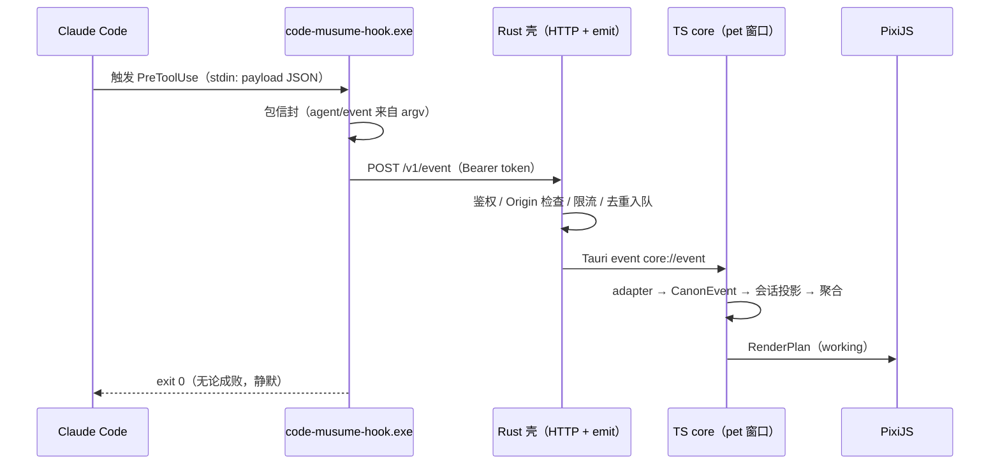
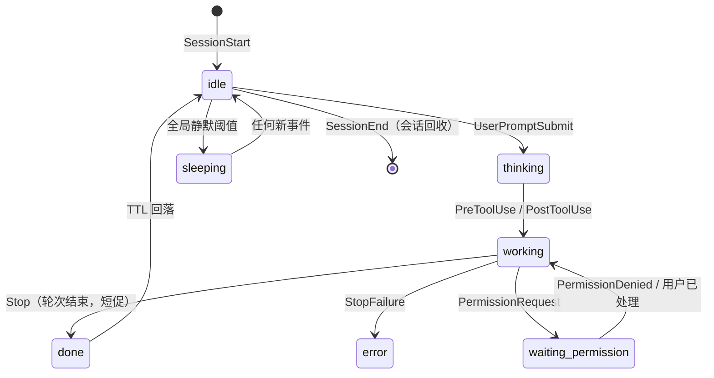

# 架构设计 — 2026-10-11（技术选型定案 + 系统架构）

> 历史文档：2026-10-14 双 agent 方案及同日架构、协议、状态规范已替代本版；仅保留历史过程与参考。

> 依据：用户 2026-10-11 指示「先完成技术选型和技术架构，并给出架构文档」；本轮由三路侦察（产品/决策/调研复核、技术素材提取、Claude Code hooks 现状核实）+ 一轮完整架构设计产出。
> 上游：`项目方案-2026-10-09.md`（路线/里程碑）、`产品定义-2026-10-09.md`（定位）、`决策记录-2026-10-09-转向自研桌宠.md`（红线）、`search\`（调研素材）。
> 边界：**本文档定「机制与结构」；字段与数值由 M0-min 两件套定**：`事件协议-2026-10-11.md`（信封 / CanonEvent / RenderPlan）与 `状态机规范-2026-10-11.md`（状态数值 / 事件映射 / 安装契约）。已迁出的内容在这里只留指针与摘要。

---

## 0. 本文档的地位与边界

### 0.1 读者与用法

- 读者：本项目的实现者（包括未来的新智能体）。开工写代码前通读 §1–§7；写 M0 规范时对照 §8 的分工原则；排查问题时回到 §2（IPC）与 §4（状态）。
- 与上游的关系：本文件**不推翻** `项目方案-2026-10-09.md` 的任何决策，只把它的「三级选型」（Tauri + TS）补全为完整定案，并把架构从「三层示意图」细化为可实现的机制设计。

### 0.2 规范性声明（防漂移的核心约定）

| 内容 | 本文档 | 规范文档（M0-min，已定稿 2026-10-11） |
|---|---|---|
| 数据流分层、模块职责、接口**形状** | ✅ 定稿 | 引用 |
| 优先级 / 衰减的**算法与机制** | ✅ 定稿 | 引用 |
| Envelope / CanonEvent / RenderPlan 字段 | ❌ 已迁出 | ✅ `事件协议-2026-10-11.md` |
| 优先级 / 衰减 / 超时的**具体数值** | ❌ 已迁出 | ✅ `状态机规范-2026-10-11.md` §5 |
| 角色包目录结构与兼容策略 | ✅ 定稿 | 引用 |
| `musume.json` 的每个字段 / 规则 DSL | ❌ 不写 | ✅ 角色包规范（M3，未写） |
| 形态规则的求解顺序 | ✅ 定稿 | 引用 |
| hook 事件 → 状态映射 / 安装契约 | ❌ 已迁出 | ✅ `状态机规范-2026-10-11.md` §7 |

**硬规则**：字段与数值一旦迁出，本档只留指针与一句摘要；修订一律改规范文档——本文档不保留任何会被规范取代的表体。

### 0.3 术语表

| 术语 | 含义 |
|---|---|
| **信封（Envelope）** | hook CLI 发给桌宠进程的线协议对象：原始 payload + 元信息 |
| **CanonEvent（归一化事件）** | adapter 把信封翻译成的、agent 无关的语义事件 |
| **会话（Session）** | 一个 Claude Code 会话 = 一个 `session_id`；桌宠以会话为状态跟踪单位 |
| **租约（Lease）** | 会话的存活判定：超时无事件即视为失联，自动降级回收 |
| **瞬态（Transient）** | 短促状态（done / notification）：超时自动回落，需防抖 |
| **聚合（Aggregate）** | 由全部存活会话的投影出全局状态（纯函数） |
| **形态（Form）** | 同一角色的一个面貌（配色/配饰/表情组合）；由「哪个 agent」决定 |
| **槽位（Slot）** | 形态之上按状态叠加的局部素材（如眼镜、贴纸） |
| **RenderPlan（渲染计划）** | core 交给 Pixi 的最终指令（动画/槽位/气泡/过渡） |
| **哑管道** | CLI 的设计原则：只转发、不解释、不决策 |

---

## 1. 架构总览

### 1.1 一句话

**hook 接入（哑管道）→ 桌宠进程（Rust 壳 + TS 核心）→ 表现（Pixi 渲染）**；所有语义集中在一处（TS core），所有红线集中在两处（CLI 的 exit 0、安装器对 settings.json 的谨慎写）。

### 1.2 进程拓扑（ASCII）

```
Claude Code ──hook 触发──▶ code-musume-hook.exe     ← 哑管道，短命进程
（各 hook 事件，stdin JSON）   │  永远 exit 0、静默、不决策
                              │  POST /v1/event（127.0.0.1 + Bearer token）
                              ▼
             ┌─────────────────────────────────────────────┐
             │ 桌宠进程（Tauri 2）                            │
             │  ┌─ Rust 壳 ────────────────────────────┐    │
             │  │ HTTP 入口(axum) / runtime 文件 / 鉴权   │    │
             │  │ 窗口管理 / 托盘 / 自启 / 单实例 / 全屏检测 │    │
             │  └──────────────┬───────────────────────┘    │
             │        Tauri event（core://event）            │
             │  ┌─ TS 核心（宿主于 pet 窗口）─────────────┐    │
             │  │ ingest → adapters → state → forms      │    │
             │  │ → render（RenderPlan）                 │    │
             │  └──────────────┬───────────────────────┘    │
             │           PixiJS（pet 窗口 WebGL）             │
             │           角色包（磁盘加载，§5）                │
             │  （settings 窗口：React 表单，纯消费者）        │
             └─────────────────────────────────────────────┘
```

### 1.3 单向数据流（五层）

```
Envelope ─▶ CanonEvent ─▶ SessionState[] ─▶ GlobalState ─▶ FormResolution ─▶ RenderPlan ─▶ Pixi
 线协议       归一化         会话维度投影        聚合           形态求解          表现指令      渲染
    └──────────────── TS core（pet 窗口）────────────────────────────┘
```

**除 ingest 与 render 两层外，全部为纯函数**（注入 `now`，不触 IO）→ 状态机与规则引擎可被 Vitest 100% 覆盖，不需要窗口。这是单人项目可维护性的关键机制。

### 1.4 三条贯穿全篇的原则

| # | 原则 | 裁决了什么问题 |
|---|---|---|
| **P1** | **`settings.json` 只写最小接线，规则全部在 TS** | 单一真相源（避免 CLI 与 TS 双份实现漂移，§2.2）；CLI 保持极简（红线风险最小）；settings.json 是高风险写区（R8），条目越少越稳；官方热重载为 best-effort（「normally」自动拾取，偶有漏检——2026-10-11 复核），不作规则分发通道。settings.json 只写：exe 绝对路径 + `--agent` + `--event` |
| **P2** | **状态是「投影」，不是「赋值」** | 每个会话持一个带租约的状态；全局状态 = 对存活会话的一次纯函数聚合。衰减/超时/重启恢复/多会话因此统一为同一机制，不需要定时器规则表 |
| **P3** | **红线优先于一切设计** | CLI 任何路径 `exit 0` + **不写 stdout（hook 模式）** + `async: true` + 静默失败、v1 不做决策输出；「只保证 exit 0」不充分——exit 0 配 `continue:false` 等 JSON 同样能阻断（2026-10-11 复核）；协议的可扩展性不允许以「可能阻塞 Claude Code」为代价 |

---

## 2. 进程模型与 IPC

### 2.1 进程拓扑与职责切分

| 进程 | 生命周期 | 职责 | 明确不做 |
|---|---|---|---|
| `code-musume-hook.exe` | 每事件一个，毫秒级 | 读 stdin → 包信封 → POST；`install/uninstall/status` 子命令 | 不解析语义、不做决策、不写 stdout（hook 模式；install/status 子命令为人读输出）、不重试到阻塞 |
| 桌宠进程（Tauri） | 常驻 | Rust 壳（IO/窗口）+ TS 核心（语义/表现） | 壳不做任何状态判断 |
| Claude Code | — | 触发 hooks | — |

### 2.2 决策：CLI 是「哑管道 + 最小信封」，不做归一化

**否决「CLI 做归一化」的理由**：规则变更需重编译重分发 exe；与 TS 侧 adapter 形成双份实现（必然漂移）；CLI 变复杂 = 红线风险上升。语义全部在 TS。

信封结构（**字段级定义见 `事件协议-2026-10-11.md` §3**，此处只留形状）：

```jsonc
{
  "v": 1,                    // 信封版本：CLI/app 版本错配检测（见 §9.4）
  "agent": "claude-code",    // 来自 argv --agent（安装器写死），不靠解析 payload
  "event": "PreToolUse",     // 来自 argv --event（同上）
  "ts": 1770000000000,       // UTC epoch ms，CLI 生成（时钟规则见 R11）
  "src": { "cli": "0.1.0", "pid": 1234 },
  "payload": "{…stdin 原样…}" // 字符串；解析失败时为原文 + parseError 标记
}
```

> R14 注：`payload` 原样仅用于内存内归一化；**不落盘、不进日志、不进诊断面板**（开发者模式显式开启除外，见 §9.3）。

**关键设计：`agent`/`event` 由 argv 传入而非从 payload 提取**——argv 是安装器写死的、权威且零成本；即使 payload 是畸形 JSON，状态机仍可工作（降级为「未知载荷的事件」）。

### 2.3 端口 / token 发现：单一 runtime 文件

- 位置：`%LOCALAPPDATA%\code-musume\runtime.json`（**不放 `%APPDATA%`**——运行态数据不漫游）
- 内容：`{ v, port, token, pid, appVersion, startedAt }`
- 规则：
  - 默认端口 `47921`，被占用则 `+1` 重试至多 10 次；
  - 实际端口只写入 runtime 文件，**CLI 永远只认文件**（端口漂移对 CLI 透明）；
  - CLI 读到 pid 后做存活检查；pid 不活 → 按 §2.4「app 未运行」处理；
  - 原子写（临时文件 + rename），避免读到半个文件；
  - **构建类型分离**：dev 与 release 各用独立 runtime 文件（如 `runtime.dev.json`），避免 `tauri dev` 覆盖正式实例的端口/token；CLI 以 `--runtime` 参数选择（默认 release）。

### 2.4 决策：app 未运行时的行为（失败策略矩阵）

| 情况 | CLI 行为 | 理由 |
|---|---|---|
| app 未运行 | **静默丢弃（默认）**；可选的「冷启动」见下 | 符合红线；且「补播旧事件」会让角色表演一个已结束的过去（P2：状态是当下投影，不是事件历史） |
| 冷启动（可选，**默认关**） | 从 `%LOCALAPPDATA%\code-musume\install.json` 取 app 路径 → detached spawn → 自身重试 POST ≤6 秒后退出；**节流**：锁文件 + 最近尝试时间戳（30s 窗口）防「多事件并发各自 spawn」的风暴；**`SessionEnd` 事件禁用冷启动**（该事件所有 hook 共享 1.5s 预算 < 6s 重试） | hook 是 `async: true`，CLI 多活 6 秒不影响 Claude Code；实现「随 Claude Code 启动」 |
| spool 文件补播 | ❌ 明确不做 | 同上，旧事件回放产生错误状态 |
| 端口占用 / token 错 / 连不上 / 超时 | 一律静默 `exit 0` | 红线 |
| payload 畸形 | 照发（原文 + 标记），由 TS 侧降级 | CLI 不做判断 |

**v1.1 候选——单槽心跳镜像**：CLI 每次事件原子覆盖写 `last-event.json`（~300B，单槽非日志）。app 启动时若发现它 <60s 新鲜且会话未结束，恢复那一个会话。解决「app 重启后对着正在干活的 Claude 显示 idle」。成本 ≈0.2ms/事件。

### 2.5 安全模型（本地回环 ≠ 安全）

1. 只 bind `127.0.0.1`；
2. `Authorization: Bearer <token>`（每次启动随机 32 hex，写 runtime 文件）；
3. **拒绝带 `Origin` 头的请求**——浏览器跨源 POST 必带 Origin，此条挡住「恶意网页往 localhost 打洞」；token 挡不住浏览器，这条能；
4. body ≤ 64 KB；令牌桶限流（~200 req/s），超出丢弃并计数；
5. 无遥测、不出网（写进 README 当卖点）。

### 2.6 Rust 壳 → TS core 的通道

- HTTP 入口在 Rust 侧（axum；Tauri 已含 tokio）。事件经 `emit("core://event")` 送达 pet 窗口。
- **否决 Node sidecar 跑 HTTP**：多一个 Node 运行时进程与生命周期管理，只为「语言统一」，不值。
- **否决 Tauri 内置 IPC**：hook 是独立进程，拿不到前端 webview 上下文。
- 节流在两层做：ingest 层 200ms 合并窗口 + 同会话同状态去重窗口（§4.5）。

### 2.7 时序：一次 PreToolUse 的旅程



### 2.8 注记：官方 `http` handler（未来可退役 CLI 的判定实验）

**已核实收口（2026-10-11）**：官方文档确认 http handler **不支持 `async`**（async 仅限 command）；连接失败为非阻断错误、执行继续；但 `SessionStart`/`Setup` 不支持 http，且无 async 意味着每个事件都会阻塞等待本地请求完成。**结论：CLI 不可退役**——观察类事件必须走 `async: true` 的 command hook 才能保证零阻塞；`http` 的价值在 v2 权限决策通道（阻塞语义正合需要，见 §4.9）。

---

## 3. 前端进程内架构

### 3.1 决策：core 宿主在 pet 窗口；settings 窗口是纯消费者

| 方案 | 裁决 |
|---|---|
| **pet 窗口持 core（选定）** | 状态机/规则引擎只在 TS 一处；settings 窗口订阅 pet 广播的快照，只读 + 发命令 |
| Rust 持状态 | ❌ 否决：语义双语言双份实现 |
| 每窗口各算一份 | ❌ 否决：必然不一致 |

配套约束：
- **pet 窗口关闭 = 隐藏，不销毁**（core 随窗口存活）；
- settings 窗口按需创建/销毁，不影响 core；
- Rust 只保留 `state_mirror`（**输入快照**：`SessionState[]` + 用户形态覆盖的只读镜像），唯一用途：pet 窗口崩溃重建时**以新 `now` 重算**恢复画面（符合 P2：投影由输入重算，不存结果）。**Rust 不做任何判断**——避免第二套语义。

### 3.2 五层职责表

| 层 | 输入 → 输出 | 职责 | 纯函数？ |
|---|---|---|---|
| ingest | HTTP/event → `Envelope` | 解码、版本检查、去重、节流 | 否（IO 边界） |
| adapters | `Envelope` → `CanonEvent` | 每个 agent 一个文件；未知字段忽略、未知事件透传 | ✅ |
| state | `CanonEvent` → `SessionState[]` → `GlobalState` | 会话生命周期、租约、优先级聚合 | ✅（注入 `now`） |
| forms | `GlobalState` + agentId → `FormResolution` | 形态规则求解 | ✅ |
| render | `FormResolution` + `GlobalState` → `RenderPlan` | 选动画/槽位/气泡/过渡/音效（`sfx`），驱动 Pixi | 否（有 ticker） |

### 3.3 adapter 接口（「加一个 agent = 写一个 adapter」的落地定义）

```ts
interface AgentAdapter {
  id: string;                       // "claude-code"
  matches(e: Envelope): boolean;    // 通常 e.agent === id
  toCanon(e: Envelope): CanonEvent[]; // 0..n（一个 hook 事件可拆成多个语义事件）
  sessionKey(e: Envelope): string;  // 会话维度键（Claude Code = session_id）
}
```

adapter 内**只做语义翻译，不做状态决策**（不决定优先级、不决定形态）。

### 3.4 建议目录树

```
apps/pet/
├─ index.html                 # 桌宠窗口入口（Pixi + core，不加载表单）
├─ settings.html              # 设置窗口入口（React 表单，不做语义）
├─ src/
│  ├─ pet.tsx  settings.tsx
│  ├─ core/
│  │  ├─ ingest/    source.ts  envelope.ts  throttle.ts  dedupe.ts
│  │  ├─ adapters/  types.ts  claude-code.ts  index.ts
│  │  ├─ state/     sessions.ts  machine.ts  aggregate.ts  lease.ts  snapshot.ts
│  │  ├─ forms/     rules.ts  resolve.ts
│  │  ├─ render/    plan.ts  atlas.ts  pixi/  bubble.tsx  transition.ts
│  │  ├─ settings/  schema.ts  store.ts  persist.ts  migrate.ts
│  │  ├─ i18n/      index.ts  zh-CN.ts  en.ts
│  │  └─ diag/      log.ts  ring.ts
│  ├─ ui/pet/  ui/settings/
│  └─ assets/
└─ src-tauri/src/  main.rs  server.rs  runtime_file.rs  windows.rs  tray.rs
                   fullscreen.rs  commands.rs  state_mirror.rs  paths.rs
```

> 注：完整 monorepo 布局与 Cargo workspace 成员以 §8.1 为准（`src-tauri/` 位于 `apps/pet/` 下）。

---

## 4. 状态模型

### 4.1 八态定义（v1）

`idle / thinking / working / waiting-permission / notification / done / error / sleeping`

**⚠️ 必须澄清的语义（否则产品文案与体验都会错）**：Claude Code 的 `Stop` = **每轮回复结束**，不是「任务完成」（且用户中断不触发）。因此：

1. `done` 的真实语义 =「**这轮好了，等你**」——它会在一轮对话里反复触发，必须**短促**（v0：~8s 回落）且有**最小显示时长**防抖；
2. `done` **绝不能覆盖** `waiting-permission`（优先级决定）；
3. 产品文案禁用「任务完成」，用「这轮好了」之类措辞。项目方案 §4 中的「任务完成」字样按此降级理解。

`transition`（换装过渡）**不是状态**，是 `RenderPlan` 上的元数据——避免状态集膨胀。

### 4.2 会话模型与租约

```ts
SessionState = {
  sessionId, agentId, cwd, permissionMode,
  state,            // 8 态之一
  stateSince,       // 进入当前状态的时刻（最小驻留/衰减用）
  lastEventAt,      // 最后一次事件（租约判断用）
  promptStartedAt,  // UserPromptSubmit 打点；回合级耗时无现成字段须自算（工具级 duration_ms 只覆盖单次工具，见 §4.6）
  ended,            // SessionEnd 后为 true
  counters,         // 工具调用数等（气泡/诊断素材）
}
```

**租约 TTL（v0：5 分钟）**：`working/thinking` 若 `now - lastEventAt > leaseTtl` → 该会话视为**失联**，降级 idle 并最终回收。这是「终端被强杀 / Claude Code 崩溃」的兜底，无需任何显式事件。**豁免**：`waiting-permission` 不因租约回收（用户可能离开很久，见 §4.5）；`error` 按自身 TTL 处理。

### 4.3 聚合算法（纯函数）

```
globalState(sessions, now):
  live = sessions.alive()                          # !ended 且（状态豁免租约 或 租约未过期）
  if live.empty: return sleepingIfQuietLong(now)   # 全局静默超阈值才 sleeping，否则 idle
  for s in live: s.effective = decay(s, now)       # 逐会话衰减（瞬态回落等）
  return maxBy(live, s => (priority(s.effective), s.stateSince))  # 先比优先级，平局取最近变化

GlobalState = { state, dominantAgentId, dominantSessionId, since }
  # dominant = 聚合胜出会话（maxBy 的返回者）——形态求解的 agentId 即 dominantAgentId（§6.1）
```



（示意；完整迁移规则见 `状态机规范-2026-10-11.md` §6。未画 Notification 旁路与 Subagent/compact 旁路。）

### 4.4 优先级（数值已迁出）

**数值**：`waiting-permission 100 > error 90 > notification 85 > done 80 > working 60 > thinking 50 > idle 30 > sleeping 10`
——唯一真相源：`状态机规范-2026-10-11.md` §5。其中 **`done = 80` 为暂定值**（架构 A9，低置信度，M2 用真实手感复审）；聚合算法（maxBy + 平局规则）见 §4.3。

### 4.5 衰减与防抖机制（机制定稿；数值已迁出）

机制（本档定稿，**数值见 `状态机规范-2026-10-11.md` §5**）：

- `done` / `notification` / `error` 是瞬态：超各自 TTL 回落至该会话基础态（idle）；
- 瞬态带**最小显示时长**（防高频闪烁）；
- **去重窗口**：同会话同状态在窗口内重复到达 → 不重放动画、不重置 `stateSince`；
- `idle → sleeping` 条件 = **全局静默**（所有会话 idle/ended）超阈值（可配）；
- `waiting-permission` **不自动过期**（用户可能真的离开很久）；超 `staleAfter` 后降级为低强度表现变体，不再刷存在感；
- ingest 层**合并节流**（Pre/PostToolUse 高频）；
- **迟到事件守卫**：同会话收到 `ts` 早于 `lastEventAt` 的事件 → 丢弃（CLI 多进程并发 POST，到达序 ≠ 触发序；不要求跨会话全局序）。

### 4.6 Claude Code 事件映射（已迁出）

**唯一真相源：`状态机规范-2026-10-11.md` §7**——安装集 15 个逐事件效果（§7.1）、不安装集 18 个及原因（§7.2）、`notification_type` 12 值分派（§7.3）、hooks 安装条目契约（§7.5）。

摘要：SessionStart→idle；UserPromptSubmit→thinking；Pre/PostToolUse→working；PermissionRequest→waiting-permission（即时主信号；Notification `permission_prompt` 为约 6 秒延迟兜底——**沙箱网络请求不触发 PermissionRequest，该路径只报后者**）；PermissionDenied→working（**仅 auto 模式触发**）；Stop→done（短促，轮次结束 ≠ 任务完成）；StopFailure→error；Subagent 不改主状态；SessionEnd→ended（全局 sleeping 由聚合推导）；Notification 12 值中 4 值映射、8 值显式忽略。

**全量事件处置（33 个）**：安装 15 / 不安装 18（逐条原因）见 `状态机规范-2026-10-11.md` §7.1–7.2。

### 4.7 用户中断的处理（已迁出）

已知盲区与缓解方向见 `状态机规范-2026-10-11.md` §8：Esc/Ctrl+C 不触发 `Stop`、无正向信号、`is_interrupt` 不覆盖「取消运行中的工具」；E10 实测后定稿。

### 4.8 重启与恢复：状态不落盘是刻意的

- 启动即 idle（无会话）→ 静默阈值后 sleeping；
- 不做状态持久化（P2：重启后的角色无从知道过去，装作知道才是错的）；
- 唯一例外 = §2.4 的单槽心跳镜像（v1.1；一份，不补播，只恢复一个会话）；
- 冷启动场景天然正确：app 被 hook 拉起 → 该事件送达 → 状态立刻正确。

### 4.9 为未来预留（v1 只留接口）

- **权限审批**：`PermissionRequest` 走**阻塞式**通道（`http` handler；其「不支持 async」已核实——阻塞语义正合决策需要），返回的决策形状为 `hookSpecificOutput.decision`：`behavior`（allow/deny）、`updatedInput`、`updatedPermissions`、`message`（deny）、`interrupt`（deny）——协议预留该响应体形状与「决策型事件」标记；v1 的 CLI **永不产生决策输出**。
- **信息展示**：信封保留原始 payload（RawPayload 通道），未来展示层可绕过 adapter 取原始字段。
- **AI 对话**：core 与表现层之间是 `RenderPlan`，未来加「对话态」只扩展 RenderPlan，不动状态机。

---

## 5. 角色包架构

### 5.1 决策：兼容 = 附加文件为主 + `x-` 命名空间字段为备，绝不改 `pet.json`

| 方案 | 裁决 |
|---|---|
| **附加文件 `musume.json`（选定）** | 零风险：只依赖目录约定，**不依赖 Codex 对未知字段的宽容度**（🔴 官方校验器是否拒绝未知字段未核实——正因为未核实，才不赌） |
| 改 `pet.json` 加顶层字段 | ❌ 否决（同上） |
| `pet.json` 内加 `"x-code-musume": {}` | 🟡 仅兜底：扩展必须与包一起被「单文件」搬运时使用（遵循 JSON 生态 `x-` 惯例） |

收益：**兼容性做成单向依赖**——原版工具读我们的包时忽略 `musume.json` 完全无损；我们读原版包只要求 `pet.json` + `spritesheet.webp`。

### 5.2 包结构：每个形态本身是一个合法的 Codex 宠物包

```
characters/<id>/
├─ pet.json                # Codex 兼容（= 默认形态）
├─ spritesheet.webp        # 1536×1872（v1，8×9）或 1536×2288（v2，8×11），单格 192×208
├─ musume.json             # 扩展：形态 / 规则 / 元数据 / 槽位 / 授权 / i18n
└─ forms/
   ├─ claude/pet.json + spritesheet.webp      # 形态 = 另一个合法包
   └─ codex/ pet.json + spritesheet.webp
```

- **图集行数 = 动画数上限**：每形态一个图集，动画行数不得超过图集行数（v1 9 行 / v2 11 行）；超出 = 校验错误（细则归 M0 角色包规范）。

这个约束很值钱：**形态可以单独导出、单独投稿 petdex / Codex 生态**（已验证的生态通路），且「换形态」与「换角色」共用同一套加载器。

### 5.3 加载路径与优先级

| 优先级 | 位置 | 读写 |
|---|---|---|
| 1 | 内置（随 app 打包，只读，示例角色） | 只读 |
| 2 | `%APPDATA%\code-musume\characters\<id>\` | 读写（用户安装） |
| 3 | `~/.codex/pets/<id>/` | 🔴 **v1 不直接挂载**，只提供设置里的「扫描并导入」（复制到 2）。理由：避免误写官方目录、避免「Codex 卸载后我们的角色消失」 |

- 校验失败**不致命**：降级到内置占位角色 + 设置窗口给一条可读错误；
- 加载结果缓存（含 mtime）；热重载仅在设置窗口「重新加载」时触发（不做文件监听，v1 没必要）。

### 5.4 工具链归属

`packages/character`（Node CLI，非 hook，可用 Node 依赖）：`code-musume-char init | validate | import | export`。schema 用 **zod**（TS 原生、可生成 JSON Schema 供编辑器补全）。

### 5.5 i18n 影响角色包 schema

角色包内的 label 等展示字段必须支持语言键（如 `{ "zh-CN": "克劳德形态", "en": "Claude Form" }`）——**此约束需写进 M0 角色包规范**。

---

## 6. 形态规则引擎 v0

### 6.1 双轴正交模型（「状态→局部表现」与「多形态」关系的答案）

```
最终呈现 = Form(agentId)  ×  Animation(state)  ×  SlotOverrides(state)

  Form      ← 由「哪个 agent」决定（低频；跨会话才变；带过渡动画）
  Animation ← 由「聚合状态」决定（高频；切帧）
  Slot      ← 由状态触发的局部叠加（dsh-lived-pet 思想；如「读文件戴眼镜」）
```

- `agentId` 的来源 = `GlobalState.dominantAgentId`（§4.3，聚合胜出会话的 agent；多 agent 并存时按此单点取值，形态不横跳）；无任何会话时回退「默认形态」。
- **形态**回答「她现在是哪个面貌」，**状态**回答「她在做什么」——两者**永不互相覆盖**。这样「Claude 形态下也可以 working」天然成立。
- 槽位思想 v1 **只落在角色包内部**（内置角色自带槽位素材），**不开放用户素材槽位**（那是 v2 的插件面）。

### 6.2 求解顺序（**反覆盖是硬规则**）

```
formLock（全局锁定）
  > overrides[agentId] / overrides[form]（用户显式选择，持久化）
  > rules[]（角色包规则，首个命中）
  > default
```

- 引擎**先查 overrides，命中即返回**；自动规则只填未被用户覆盖的键——直接对应 dsh-lived-pet 的「用户手动选过的槽位不被自动覆盖」先例。
- 手动切换必须区分**「仅本次」/「记住」**两种语义（UI 上是「预览」和「设为默认」）；只有后者写 overrides。

### 6.3 过渡与防抖

- `minFormDwellMs`（v0：~5s）：形态切换后短时间内不因 agent 抖动再切换；
- 同一形态重复命中 → **不重放换装动画**；
- 形态切换一律走**过渡**（淡出/换装/淡入），时长归角色包声明。

### 6.4 产品层提醒

核心 demo 是「切 agent 变形态」——若用户 `formLock` 了，卖点即失效。设置里必须有**默认开启、位置显眼的「自动形态」开关**。

### 6.5 与状态聚合的关系

**一次事件 → 一次聚合 → 一次 form 求解**。形态求解**不得**依赖事件历史（保证纯函数可测）。

### 6.6 陪伴层（架构留位）

- 「双核心」之一的陪伴感需要一个机制位：**idle 行为调度**——在 idle 状态下由渲染层调度随机小动作/变体（**不改变状态、不进状态机**），素材与频率由角色包声明。
- v1 可选（低成本可收）；本架构只保证机制位存在，具体行为清单归 M0/后续。

---

## 7. 窗口与桌宠行为（Tauri 2 视角）

### 7.1 属性矩阵

| 项 | v1 | 实现要点 |
|---|---|---|
| 透明 / 无边框 | ✅ | `transparent: true, decorations: false, shadow: false`（**`shadow:true` 会在 Win11 无边框窗上加 1px 白边+圆角**）+ `noRedirectionBitmap: true`（Windows 透明窗白闪，2026-10-11 核实）——**创建时确定，运行期不可改**。HTML/body 背景透明；**`backgroundColor` 的 alpha 在 Windows 被忽略，不能靠它做透明**。🔴 WebView2 + WebGL 透明有性能路径差异，**M1 第一步实测**（§12.D，含 `noRedirectionBitmap` 对照臂） |
| 置顶 | ✅ | `alwaysOnTop: true`（HWND_TOPMOST）。独占全屏游戏仍会盖住——接受 |
| 任务栏隐藏 | ✅ | `skipTaskbar: true` |
| **不抢焦点** | ✅ | `focus: false`（初始不聚焦；**键名是 `focus` 不是 `focused`**）+ `focusable: false`（= `WS_EX_NOACTIVATE`，**Tauri ≥2.8 已内建**，2026-10-11 核实；`with_webview` 手写降为兜底）。**这是「不干扰工作」的关键**——点角色不能把终端的前台焦点抢走。🔴 需实测（注意：仅 `focus:false` 的窗口在 show 后仍会被聚焦——必须靠 `focusable`） |
| 拖动移动 | ✅ | 用 `startDragging()`（`@tauri-apps/api/window`），**不用** `data-tauri-drag-region`（会吞掉本应给角色的点击） |
| 点击穿透 | ✅ 分层（§7.2） | L1 + L2 做，L3 留 v1.1 |
| 全屏抑制 | ✅ | 检测前台窗口是否覆盖显示器工作区全矩形（或 `SHQueryUserNotificationState`）→ 隐藏窗口 + 停 ticker；恢复时还原（§7.3） |
| DPI | ✅ | **一律存物理坐标 + 显示器标识**；显示时按该显示器 scale factor 反算并 clamp 进工作区（§7.4） |
| 多显示器位置记忆 | ✅ | `{monitorDeviceId, xPhys, yPhys}`；显示器不在场 → clamp 到主屏 |
| 开机自启 | ✅（默认关） | `tauri-plugin-autostart`；设置里一键开 |
| 单实例 | ✅ | `tauri-plugin-single-instance`；第二次启动把参数转交首实例（如 `--settings`）后退出 |
| 托盘菜单 | ✅ | 显示/隐藏、穿透模式、形态切换、开机自启、设置、退出 |
| 隐藏 = 不渲染 | ✅ | 不可见/全屏时停 Pixi ticker；idle 降帧（如 60→24）；常驻占用是硬指标 |
| 禁用干扰 | ✅ | 屏蔽右键菜单、文本选择、Ctrl+滚轮缩放、release 关闭 devtools |

### 7.2 点击穿透的三个层次（大多数实现会在这里想错）

| 层次 | 手段 | v1 |
|---|---|---|
| L1 全窗穿透 | `set_ignore_cursor_events(true)` | ✅（托盘/热键切换的「幽灵模式」） |
| L2 窗口贴紧角色 | 窗口尺寸 = **精灵 + 气泡 + 槽位素材的并集包围盒**（角色包声明各占位框），最小化空白区域 | ✅（**v1 主手段**） |
| L3 按像素穿透 | 原生 `WM_NCHITTEST` 返回 `HTTRANSPARENT`（子类化 HWND） | ❌ 留 v1.1 |

> ⚠️ **务必记住的误区**：CSS `pointer-events: none` **不能**让窗口穿透——窗口仍会吃下透明区域的点击。这句话的代价是一次真实的踩坑。
> 🔴 `set_ignore_cursor_events` 在 Windows 上有「窗口 show/hide 后需重新应用」的已知问题，M1 实测确认。

### 7.3 全屏抑制

- 目标：全屏游戏/演示时自动让位（同类先例：SlopBar 全屏自动隐藏、Lively Wallpaper 前台进程检测）。
- 实现：定时（如 2s）检测前台窗口矩形是否覆盖显示器全矩形 → 命中则隐藏 + 停 ticker；退出全屏恢复原状态。
- 与红线一致：**不抢占前台、不干扰**。

### 7.4 DPI 与坐标规则（项目已记录的坑，写成代码规范）

1. 存储一律用**物理像素坐标 + 显示器标识符**；
2. 显示时按目标显示器 scale factor 反算逻辑坐标，并 clamp 进工作区；
3. 任何「窗口尺寸/位置」代码 review 时先问：**这是物理还是逻辑？**
4. 多显示器热插拔（显示器增删）→ 重算并 clamp。

### 7.5 托盘 / 单实例 / 自启

见 §7.1 表；单实例的参数转交（`--settings` 直达设置窗口）是「再次点击图标」的预期行为。

### 7.6 帧率与省电

- idle 降帧；不可见/全屏停 ticker；电池模式（可选，v1.1）；
- 常驻应用的口碑点，写进 README 卖点。

---

## 8. 工程结构与工具链

### 8.1 monorepo 布局（在项目方案 §6 骨架上细化）

```
Code-musume/
├─ apps/pet/                  # Tauri 应用（前端 + src-tauri）
├─ packages/protocol/         # CanonEvent 类型、优先级常量、版本号（TS，无运行时依赖）
├─ packages/character/        # 角色包 schema + 校验器 + 脚手架 + Codex 导入（Node CLI）
├─ hooks/cli/                 # Rust bin: code-musume-hook（哑管道 + install/uninstall/status）
├─ docs/
├─ Cargo.toml                 # workspace root: ["apps/pet/src-tauri", "hooks/cli"]
├─ pnpm-workspace.yaml        # ["apps/*", "packages/*"]
├─ biome.json
└─ package.json               # packageManager 字段锁 pnpm 版本
```

**三处取舍说明**：

1. **hook CLI 与 Tauri 共用一个 Cargo workspace**（共享 `target/`、共用 serde 版本）；代价是 `default-members` 处理，收益是编译时间与依赖一致性。
2. **`hooks/installer` 不单独建包**：安装逻辑做成 hook CLI 的子命令（`code-musume-hook install|uninstall|status`）——单一实现；天然复用「exe 已随 app 安装」；可无 GUI 测试。设置窗口的「一键安装」= Rust 侧 invoke 该子命令。
3. **`packages/protocol` 零运行时依赖**（只有类型 + 常量），hook CLI、两个窗口、校验器都可安全引用。

### 8.2 构建

- **双 HTML 入口**（`index.html` / `settings.html`），Vite `build.rollupOptions.input`：pet 首屏只加载 Pixi 不加载表单组件，settings 反之；
- `beforeDevCommand: pnpm dev`；`frontendDist: ../dist`；
- CLI 单独 `cargo build -p code-musume-hook --release`，作为构建产物嵌入 Tauri bundle（externalBin / resources）；
- **CLI 依赖极薄**：`serde` + `serde_json` + **`std::net::TcpStream` 手写 HTTP/1.1 POST**（不引 tokio/reqwest）→ 目标二进制 <1MB、冷启动 <10ms。
- 🔴 **未核实（R6 的关键前提）**：hook 安装的 `args` exec 形式（不经 shell）在 Windows 上的实际行为，须以「含空格 + 中文路径」在 M1 实测收口。

### 8.3 TS 基线

`strict: true`、`noUncheckedIndexedAccess: true`、`verbatimModuleSyntax: true`、`moduleResolution: "bundler"`、`target: ES2022`；`tsc --noEmit` 作为 CI 门禁。

### 8.4 Lint：Biome（结论）

单工具（lint + format 一体、无插件冲突）、Rust 实现（秒级）、单人项目维护成本最低。备选：需要类型感知规则（如 `no-floating-promises`）时回退 ESLint + typescript-eslint，代价是配置量与 CI 时间。Rust 侧 `cargo fmt` + `clippy -D warnings`。

### 8.5 测试策略

- **Vitest**：`packages/protocol`、`packages/character`、core 的 `state/` `forms/` `adapters/`（纯函数，覆盖可做很高）；
- **契约测试**：真实 Claude Code hook payload 快照存 `packages/protocol/fixtures/`，对 adapter 做快照测试——**防「官方事件演进打断我们」的第一道防线**（R1）；
- **Rust**：只测 install 的 settings.json 合并/卸载与 runtime 文件读写（最危险的两块）；
- 明确不做（v1）：E2E、视觉回归。

### 8.6 CI 轮廓（GitHub Actions）

| Job | Runner | 内容 |
|---|---|---|
| lint + types + test | ubuntu（快、便宜） | pnpm install / biome ci / tsc --noEmit / vitest |
| rust lint + test | **windows-latest** | fmt --check / clippy -D warnings / cargo test（路径与设置合并逻辑平台相关，必须 windows） |
| bundle | windows-latest（tag 触发） | tauri build + CLI build + 上传 artifact |

单一平台起步（Windows-first）；macOS matrix 留 v2。

---

## 9. 配置、数据与运维

### 9.1 落盘位置

| 数据 | 位置 | 说明 |
|---|---|---|
| 用户配置、角色包 | `%APPDATA%\code-musume\` | 可漫游（characters/、config.json） |
| runtime.json / install.json / 日志 / 心跳镜像 | `%LOCALAPPDATA%\code-musume\` | 不漫游 |
| hooks 配置 | 用户级 `~/.claude/settings.json`（安装器写；见 §9.4） | 带标记条目 |

### 9.2 配置写入容错

原子写（临时文件 + rename）+ `.bak` + 「最后一份可用配置」回退；schema 版本号 + 迁移函数；**配置损坏不能导致桌宠起不来**（降级默认配置 + 可读提示）。

### 9.3 日志与诊断

- 三层：(a) CLI 日志（`CODE_MUSUME_DEBUG=1` 才写，JSONL，5MB 轮转）；(b) app 结构化日志（Rust `tracing` + 前端 ring buffer）；(c) ⭐ **设置窗口的「事件流查看器」**：最近 N 条（原始信封 → 归一化 → 聚合决策 → 最终 RenderPlan）。
- 诊断面板是单人开发 M2 调状态机时**唯一能活得下去的工具**，建议 M2 就做。
- **脱敏纪律（配合 R14）**：持久化与诊断面板走**字段白名单**（事件名 / `session_id` 短哈希 / `tool_name` / 时间 / 状态与决策），**默认不含** prompt、代码、路径、`last_assistant_message`；显示原始 payload 是开发者模式的显式开关。

### 9.4 hooks 安装 / 卸载 / 升级

- **安装**（`install` 子命令）：dry-run → 备份 settings.json → 只增带标记的条目（每条 = 事件名 + exec 形式 + 绝对路径 + `--agent` + `--event` + `async: true`）；检测到 JSON 损坏时**拒绝写入**。
- **幂等**：`install` 先按标记精确移除本工具旧条目再写入（重复执行绝不产生重复条目）；`uninstall` 同样幂等。
- v1 安装事件清单（15 个）：SessionStart / SessionEnd / UserPromptSubmit / PreToolUse / PostToolUse / PostToolUseFailure / PermissionRequest / PermissionDenied / Notification / Stop / StopFailure / SubagentStart / SubagentStop / PreCompact / PostCompact。
- **卸载**：按标记精确移除（不碰用户其它 hooks）；**Tauri NSIS 卸载钩子也要清**（容易漏）。
- **热重载为 best-effort**（2026-10-11 复核）：官方文件监视器「normally」自动拾取 hooks 改动，偶有漏检 → 安装/升级后提示「若未生效，重开会话」；`/hooks` 菜单可查看当前生效配置（引导用户自检）。
- **SessionEnd 预算**：该事件所有 hook 共享 1.5 秒默认预算（单条 `timeout` 或 `CLAUDE_CODE_SESSIONEND_HOOKS_TIMEOUT_MS` 可抬，上限 60s）——CLI 毫秒级，满足；禁止给 SessionEnd 挂任何阻塞逻辑。
- **信任门槛**：交互式会话在用户接受目录的 workspace trust 前**不运行任何 settings hook**（含用户级）——首次运行引导必须覆盖这一步。
- **版本错配**（R9）：信封带 `v`；不匹配时 **CLI 主动放弃发送**（宁可丢事件，不发新格式给老 app）；app 启动时比对 `install.json` 记录的 CLI 版本与内置 CLI 版本，不一致 → **在角色身上给可见反馈**（失联/告警表现）+ 设置窗口「已安装 hook 版本」与一键重装。
- `status` 子命令 + 设置窗口首页显示安装状态。

### 9.5 首次运行引导

装完不知道要开 Claude Code 会话 → 一节引导：「安装 hooks → 开个 Claude Code 试试 → 看她动」。P0 体验项。

### 9.6 其余产品级点

| 点 | 说明 |
|---|---|
| 升级机制 | v1 不做自动更新（updater 需签名密钥 + 服务器），但**必须做版本兼容**（R9）与「重装 hooks」入口 |
| i18n | `t()` + 文案 JSON，v1 做 zh-CN / en；**角色包 label 也支持语言键**（§5.5，影响 M0） |
| 减少动画开关 | 尊重 reduced-motion；低成本的细节加分项 |
| 「请求注意」分级 | waiting-permission / notification / done 三态的**表达强度要有层次**（动画强度/气泡/是否发声），否则看起来一样 |
| 数据可携带 | overrides、位置、窗体偏好可导出/导入（作品集加分 + 换机） |
| 开发者模式 | 强制设状态、重放 fixture、显示 hit-box 边界——M1/M2 调试效率取决于此 |

---

## 10. 风险清单（增量，叠加于项目方案 §7）

| # | 风险 | 严重度 | 对策 |
|---|---|---|---|
| R1 | **hooks API 演进快**（已从 15 → 33 事件；`notification_type` 等枚举仍可能变） | 高 | adapter「未知字段忽略、未知事件透传」；信封带 `v`；payload 快照契约测试；维护清单写「每季度 diff 一次官方 hooks 文档」 |
| R2 | **hooks 热重载为 best-effort**（官方「normally」自动拾取；监视器偶发漏检） | 低 | 安装/升级后提示「若未生效请重开会话」；`/hooks` 自检引导 |
| R3 | **AGPL 参考边界**（clawd-on-desk 为 AGPL-3.0；cc-haha / MiniCPM-Desk-Pet 是其衍生） | 高 | **红线：一行代码都不抄**。允许的只有公开格式规范（Codex pet 包）、交互思想、状态映射先例的「结论」。落成 §12.B 声明 |
| R4 | **官方能力撞车**（Codex Pets 官方、Claude Buddy、Anthropic 硬件桌宠） | 高 | agent-agnostic + 自有协议 + 原创 IP；价值锚在跨 agent 与长期陪伴 |
| R5 | **依赖体重** | 中 | Pixi 只进 pet chunk；不引 UI 组件库（手写 CSS）；protocol 包零运行时依赖；锁版本 + 年度升级窗口 |
| R6 | **Windows 特有坑** | 高 | 路径含空格/中文 → exec 形式 + 绝对路径（不经 shell）；DPI 物理/逻辑；WebView2 运行时分发模式（downloadBootstrapper 需联网 → 决定 embed/offline）；未签名 exe 的 SmartScreen 警告（接受并说明，或 winget/Scoop 分发）；**路径写错 → 退出码 127 且静默**（安装器必须自检路径可执行） |
| R7 | **hook 高频触发**（密集工具调用下每秒多次） | 中 | CLI 无状态；ingest 200ms 合并节流 + 去重窗口；渲染与状态解耦 |
| R8 | **改用户全局 settings.json 是高风险写** | 高 | dry-run、备份、只增标记条目、按标记精确卸载、损坏拒绝写（§9.4） |
| R9 | **版本错配**（app 升级了但 CLI / settings.json 是旧的） | 中 | 信封 `v` + 不匹配放弃发送 + 设置窗口重装入口 |
| R10 | **多会话/多项目并发** | 低 | 上限 8 个活跃会话，超出丢最旧/最低优先级；设置窗口可见会话列表 |
| R11 | **时钟/时区** | 中 | 跨进程一律 **UTC epoch ms**；时长用单调时钟（`Instant` / `performance.now()`）自算；**禁止本地时间字符串进协议** |
| R12 | **Rust 工具链未安装**（2026-10-11 实测） | — | M1 前置条件 |
| R13 | **「写文件→观察」周期教训的延续** | 中 | 未来若做「状态落盘供外部观测」（OBS/直播集成），必须先测写周期再下结论（本项目最大教训） |
| R14 | **隐私**（`transcript_path`、`last_assistant_message`、`cwd`、工具参数含代码） | 中 | **默认气泡只显示状态文案**，不显示 prompt / 代码 / 路径 / 最后消息；「显示摘要」是显式开关；`transcript_path` 永不读取（官方警告异步写、滞后）；协议只传必要字段；**持久化/日志/诊断面板走字段白名单脱敏**（§9.3） |
| R15 | **WebView2 + 透明 + WebGL 的性能路径** | 中 | M1 第一步实测；不达标的后备：DOM/CSS 精灵（放弃 Pixi）或降分辨率 |
| R16 | **协议 TS/Rust 双份实现漂移**（信封在 CLI 与 ingest 各实现一次——正是否决 CLI 归一化的那条理由的复发点） | 中 | 唯一真相源 = `packages/protocol`（schema + fixtures）；CI 双向契约测试（Rust 生成→TS 校验；TS 期望→Rust 生成） |

---

## 11. 决策记录摘要（ADR）

| # | 决策 | 理由 | 备选（未采用） | 置信度 / 复审触发 |
|---|---|---|---|---|
| A1 | 壳 = Tauri 2 | 项目方案已定（占用小 / 生态厚 / 跨平台） | Electron、WPF | 高 |
| A2 | UI = React | 贡献者池最大；作品集价值 | Svelte、Vue、无框架 | 高（用户 2026-10-11 定） |
| A3 | 渲染 = PixiJS | 精灵表/图层/色调滤镜一等公民；「换配色形态」受益 | 原生 Canvas、DOM/CSS | 中高（🔴 M1 实测透明+WebGL 性能，见 R15） |
| A4 | CLI = Rust 哑管道（argv 传 agent/event） | 红线最稳；规则集中 TS（P1：单一真相源，不依赖 settings.json 分发） | CLI 做归一化；Node 脚本 | 高 |
| A5 | IPC = 本地 HTTP + token + runtime 文件 | 项目方案已定范式；端口漂移对 CLI 透明；可用 curl 直测 | Tauri IPC（hook 进程拿不到 webview 上下文）；命名管道（Windows 特化、CLI 需 Win32 API、调试难） | 高 |
| A6 | app 未运行 = 静默丢弃（冷启动默认关） | 红线；P2（补播=错误状态） | spool 补播、默认冷启动 | 高（冷启动默认值可复审） |
| A7 | HTTP 在 Rust 壳，core 宿主于 pet 窗口 | 避免双份语义；settings 为纯消费者 | Node sidecar、Rust 持状态 | 高 |
| A8 | 状态 = 每会话投影 + 租约 + 纯函数聚合 | 多会话/衰减/重启统一机制；可全量单测 | 全局单状态机 | 高 |
| A9 | `done` 优先级 v0 = 高于 working | 打断信号优先；Codex 先例支持（Ready > Running）；Hopet/vibe-lamp 相反 | 低于 working | **低——🔴 M2 真实手感复审；M0 冻结数值时须标「暂定（M2 复审）」** |
| A10 | 兼容 = `musume.json` 附加文件 | 不赌 Codex 对未知字段的宽容度（未核实） | 改 pet.json、`x-` 字段 | 中高 |
| A11 | 形态 = 合法 Codex 包的聚合 | 形态可独立投稿生态；加载器复用 | 单一 atlas 变体 | 高 |
| A12 | 形态/状态双轴正交 + 反覆盖 | 状态不吞形态；用户偏好不被自动覆盖 | 形态随状态联动切换 | 高 |
| A13 | `~/.codex/pets/` 仅导入不挂载 | 不误写官方目录；避免卸载连带 | 运行时挂载 | 中高 |
| A14 | Lint = Biome | 单工具、秒级、维护成本低 | ESLint + Prettier | 中（需类型感知规则时回退） |
| A15 | 状态不落盘（除 v1.1 单槽心跳） | P2；重启装懂过去才是错的 | 全量持久化 | 高 |
| A16 | 权限审批 v1 只预留（阻塞式 http hook 通道） | 项目方案 v1 范围 | v1 实现 | 高 |

---

## 12. 附录

### A. 术语

见 §0.3。

### B. 参考边界声明（AGPL 与素材）

- **代码**：本项目只参考公开讨论的**格式规范与结论**（如 Codex 宠物包格式 = 事实标准、clawd-conduit 的状态映射结论、Hopet/Codex 的优先级排序思路）；**不复制任何 AGPL-3.0 项目（clawd-on-desk 等）的代码**。「参考边界」红线落档于本附录，实现阶段严格执行。
- **素材**：全原创（产品定义已定）。代码许可 MIT + 角色素材 CC BY-NC 4.0（对齐生态惯例，项目方案 §6）。
- **观测红线延续**：不逆向、不解密、不注入；hooks 只走官方机制。

### C. 参考实现清单（各取什么）

| 参考 | 取什么 | 不取什么 |
|---|---|---|
| Codex Pets（官方） | 精灵表格式（pet.json + spritesheet.webp；8×9/8×11 @192×208） | 代码 |
| clawd-conduit | 事件→状态映射结论（7 条） | 代码（架构不同） |
| clawd-on-desk | 「1 SVG + 7 GIF 主题」的多状态表达思路、脚手架/校验器的**产品思路** | AGPL 代码、具体实现 |
| dsh-lived-pet | 「状态→槽位换装 + 不覆盖用户选择」的交互思想 | 代码 |
| Hopet / vibe-lamp / Codex | 多会话优先级聚合的排序结论 | 代码 |
| DyberPet | 「最低动作集 + 自动回退」的角色包宽容度设计 | 代码（GPL） |

### D. 待验证实验清单（→ M0 / M1，方法学：先最小判定实验，再改架构）

| # | 实验 | 影响 | 时机 |
|---|---|---|---|
| E1 | WebView2 + 透明 + WebGL 的实际表现与性能（含 `noRedirectionBitmap` 开/关对照臂） | R15 后备方案（是否保留 Pixi） | **M1 第一步** |
| E2 | `set_ignore_cursor_events` 在 Windows 上 show/hide 后是否失效 | 穿透实现 | M1 |
| E3 | 验证 Tauri 内建 `focusable:false` 是否等于 `WS_EX_NOACTIVATE`、有无副作用（含 `focusable:true` 反向对照） | 不干扰红线 | M1 |
| E4 | DPI 物理/逻辑坐标实测（多显示器 + 缩放） | §7.4 规范验证 | M1 |
| E5 | ~~http handler async / 失败语义~~ **已核实收口**（2026-10-11）：不能 async、失败非阻断 → CLI 不可退役（§2.8） | — | ✅ 已收口 |
| E6 | CLI 冷启动延迟实测（exe 每次调用的开销） | 高频事件预算 | M1 |
| E7 | `/clear` 与压缩是否更换 `session_id` | 会话跟踪稳健性 | M0 期间 |
| E8 | `notification_type` 完整枚举核实 | 映射表定稿 | M0 期间 |
| E9 | WebView2 音频自动播放策略（无用户手势能否出声） | 「声音」核心的可行性 | M1 |
| E10 | 用户中断（Esc / Ctrl+C）实测：是否存在任何可用信号（`is_interrupt` 经核实**不覆盖**「取消运行中的工具」） | §4.7 中断回落设计定稿 | M0 期间 |

### E. 待决问题（不阻塞）

- `done` 优先级终值（M2 复审，A9）
- 冷启动默认值（A6）
- 自动更新方案（v2）

### 变更记录

| 日期 | 变更 |
|---|---|
| 2026-10-11 | 初版：技术选型定案（含用户确认 React/PixiJS）+ 完整系统架构；三路侦察（hooks 现状核实至 33 事件）+ 一轮架构设计产出 |
| 2026-10-11 | 评审修订批次（P0/P1/P2）：官方文档复核收口 5 项事实（热重载 best-effort / notification 12 值 / http 不支持 async / PermissionRequest 决策形状 / 中断无正向信号）；§4.6 增全量 33 事件处置表与枚举补全；红线加强为「exit 0 + 不写 stdout」；新增 §4.7 中断盲区；新增 R16、E9/E10；其余一致性修订 30+ 处 |
| 2026-10-11 | **M0-min 冻结回改**：字段与数值迁至 `事件协议-2026-10-11.md` / `状态机规范-2026-10-11.md`（删表体、留摘要+指针）；落地核对修正 C1–C8（focus/focusable、noRedirectionBitmap、shadow、PermissionDenied 仅 auto 模式、E1/E3 描述、SessionEnd 禁冷启动、exec 形式待实测、目录树以 §8.1 为准） |
