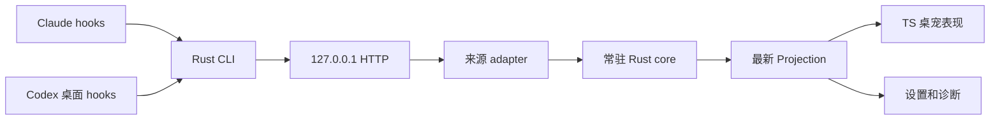

# 架构设计 — 2026-10-14

> 现行；替代 2026-10-11 的 TS 窗口核心方案。Tauri + TypeScript 保留，工作语义移至唯一的 Rust 核心。

## 进程与数据流

- contracts：CLI/app 共用信封、配置、Projection、角色 manifest；ts-rs 生成 TS 类型。
- core：纯 adapter、活动/等待/提示模型、并发隔离和聚合；注入单调毫秒，不读文件、时钟或窗口。
- Tauri 宿主：HTTP、时钟、串行消息入口、托盘/窗口、配置与角色资源、安装器调用。
- TS：仅消费快照、过滤过期修订、播放动作和处理本地陪伴互动。设置提交原生命令，不写第二套工作状态机。

核心单一所有者使用有界消息队列，事件和设置串行处理。工作状态不依赖 Pixi ticker。250ms 定时重算过期与静默；仅状态快照修订变化时广播。当前订阅仅保留每窗口一个，订阅使用独立 token；旧窗口的迟到取消不能移除新订阅。

## 生命周期与存储

订阅注册与初始快照在核心入口同一操作完成；Channel 传输状态。隐藏暂停渲染，显示时拉取最新快照；窗口重载重订阅。运行状态仅在内存中，整体进程重启不回放旧活动。

runtime 文件发布在核心/监听器初始化后，包含 v、port、随机 token、pid、appVersion、instanceId、startedAt；默认 47921–47930。dev / release 分文件，退出仅删除匹配当前 instanceId 的文件。

配置与角色在 APPDATA/code-musume，runtime 和安装回执在 LOCALAPPDATA/code-musume。配置写入使用临时文件与 rename。测试通过 CODE_MUSUME_DATA_DIR / CODE_MUSUME_CONFIG_DIR 指定隔离目录。运行时不读取 transcript。

## 接入与资源界限

HTTP 仅回环、Bearer 常数时间比较、拒绝 Origin、200/s 令牌桶、2MiB 信封限制。原始 stdin 256KiB；JSON 转义后的大小另算。排队上限 128 条/8MiB，满载拒绝并计数；无静默扩大队列。

CLI 有进程内截止看门狗，包含阻塞 stdin；hook 模式始终 exit 0、无 stdout/stderr、无控制输出、无重试与自动拉起。ureq 关闭 TLS/代理/重定向。普通截止 300ms，Codex SessionEnd 100ms（不包含宿主命令启动开销）。

Claude 用 command + args；Codex 独立生成 command/commandWindows，PowerShell UTF-16 EncodedCommand 保护中文、空格和 shell 字符。Codex SessionEnd 同步，其他观察事件异步。定义信任由用户在 Codex 内完成，不能绕过。

## 安装与显示

安装器按来源和 dev/release 识别自身条目。预览返回当前摘要与只含自身的接线变化；写入必须带预览摘要，变更后拒绝写。Claude 采用严格 JSON；Codex 已有内联 hooks 则沿用 TOML，否则 hooks.json。保留无关设置；TOML 外层格式保留，hooks 子树由结构化序列化器更新。

回执保存原字节和安装后摘要：没有外部编辑时卸载可字节回滚；有编辑时仅移除自身条目。升级与两家卸载独立，用户级写入由设置中的明确操作触发。

透明、置顶、无任务栏、不聚焦；显示路径统一重新应用穿透。位置存物理坐标与显示器标识，恢复及显示器变化时夹到工作区范围。全屏自动隐藏，托盘可显示/隐藏/切穿透/设置/退出。开机启动默认关，仅显式设置写当前用户 Run 项。

## 角色与扩展

角色包是声明式 musume.json + PNG/WebP，不执行脚本。Rust 验证路径、图集、动作与映射；仅复制导入，不挂载外部目录。保留原 pet.json 和授权文本。v1/v2 Codex 图集经结构检查后转内部 clips；缺失/损坏包回退示例或拒绝导入。

自动映射顺序：全局锁定 → 用户来源覆盖 → 包来源映射 → 默认形态。演员状态与形态独立。新增 agent 只添加 adapter、capabilities 与安装配置生成，不改变前端状态语义。未来审批使用独立决策通道，不复用观察 CLI。
