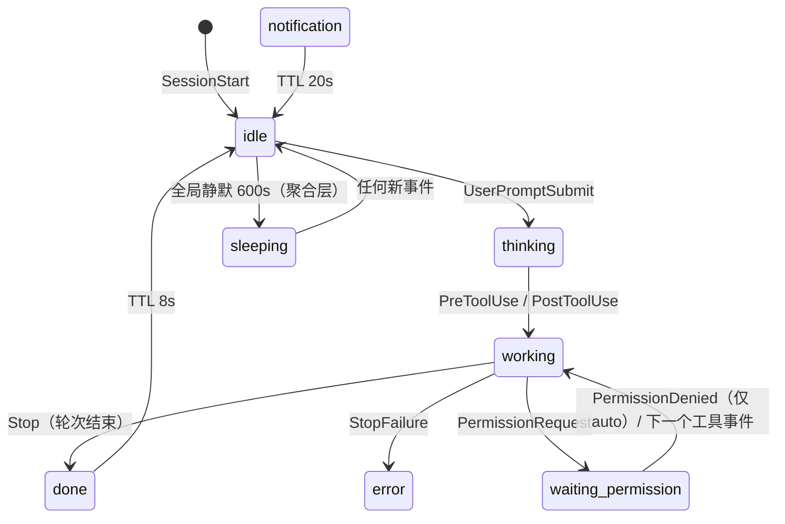

# 状态机规范 — 2026-10-11（M0-min 冻结）

> **地位**：本文件是【状态集 / 数值 / 迁移规则 / 聚合算法 / 事件映射 / hooks 安装契约】的**唯一真相源**（架构文档 §4 的机制描述仍归架构文档；数值与映射以本文为准）。
> **上游机制来源**：`架构设计-2026-10-11.md`（P2「状态是投影」、会话租约、聚合、衰减机制）。
> **事实来源**：2026-10-11 官方文档复核（附录 B）。
> **复审触发**：`done` 优先级（A9，M2 用真实手感复审）；E10（中断）后定稿 §8；E7/E8 后修订 §3.2 / §7.3。

---

## 1. 范围

本文冻结：8 态状态集与语义、会话模型、租约与回收、全部数值、迁移与聚合规则、事件映射表、hooks 安装条目契约、waiting-permission 退出条件。

---

## 2. 状态集与定义（8 态）

| id | 中文 | 语义 | priority | 瞬态 | 租约豁免 | minDwell | 自身 TTL | 表达强度 |
|---|---|---|---|---|---|---|---|---|
| `waiting-permission` | 等你授权 | 工具调用需要用户批准 | **100** | 否 | ✅ | — | 不过期（stale 降强度） | 高（高亮+招手+气泡） |
| `error` | 出错 | 回合因 API 错误终止 | 90 | 否 | 否（走 TTL） | — | 60s | 高 |
| `notification` | 提醒 | 温和提醒（如等待 60s） | 85 | ✅ | 否 | 4s | 20s | 中 |
| `done` | 这轮好了 | **每轮回复结束**（≠任务完成） | **80（暂定，M2 复审）** | ✅ | 否 | 4s | 8s | 中低（短促） |
| `working` | 干活中 | 工具调用进行 | 60 | 否 | 否 | — | 租约 300s | 中 |
| `thinking` | 思考中 | 提交 prompt 后、工具前 | 50 | 否 | 否 | — | 租约 300s | 低 |
| `idle` | 空闲 | 无活动 | 30 | 否 | 否 | — | — | 低 |
| `sleeping` | 睡着 | **全局**静默超阈值（非单会话态） | 10 | 否 | — | — | — | 最低 |

**语义澄清（必读）**：
1. `done` = 「**这轮好了，等你**」——`Stop` 每个回合结束都触发（用户中断**不**触发），因此 done 必须短促、防抖（minDwell + 去重窗口），且**不得覆盖**同会话的 waiting-permission（§6.1 守卫）。产品文案禁用「任务完成」。
2. `error` 不持久化到租约之外；`StopFailure.error` 的 12 种细分 M1 统一按 error 处理。
3. `sleeping` 是**聚合产物**：当且仅当全部会话 idle/ended 且全局静默 > `sleepingAfterIdleMs` 时，全局呈现 sleeping；任何新事件立即唤醒。

**强度分级（请求注意三级）**：waiting-permission（100，强）> notification（85，中）> done（80，弱短促）——三级必须在动画/气泡/时长上可区分。

---

## 3. 会话模型

### 3.1 SessionState 字段表

| 字段 | 类型 | 含义 |
|---|---|---|
| `sessionId` | string | 会话键 |
| `agentId` | string | 来源 agent |
| `cwd` | string？ | 仅内存（R14） |
| `permissionMode` | string？ | 同上，可缺省 |
| `state` | 8 态之一 | 当前态 |
| `stateSince` | int64 | 进入当前态时刻（minDwell/衰减/平局用） |
| `lastEventAt` | int64 | 最后事件时刻（租约判断） |
| `promptStartedAt` | int64？ | UserPromptSubmit 打点（回头合耗时） |
| `ended` | boolean | SessionEnd 后 true |
| `counters` | object | `{ toolCalls, failures, subagents }`（诊断/气泡素材） |
| `dominantSeq` | number | 迟到守卫用（按 ts 单调） |

### 3.2 会话身份

- `sessionKey = session_id`；缺失 → 兜底 `"unknown:<pid>:<event>"`。
- 🔴 **未收口**（E7）：`/clear` 与压缩是否更换 `session_id` 官方未明说 → 实测后修订本节。对应事件序列为 `SessionEnd(clear)` → `SessionStart(clear)`、`SessionStart(compact)`，**状态机以事件序列为状态源，不依赖 ID 推断连续性**。

### 3.3 会话上限与淘汰

- `maxSessions = 8`。新增会话时若已满，按顺序淘汰：① 已 ended 的最旧会话 → ② 最低优先级 → ③ `lastEventAt` 最旧。
- `ended` 会话保留到被淘汰或全局静默回收（保留 counts 供气泡历史，M1 不展示）。

---

## 4. 租约与回收

- **`leaseTtl = 300_000 ms`**：`working` / `thinking` 若 `now - lastEventAt > leaseTtl` → 视为失联，降级 idle 并纳入回收。
- **豁免表**：`waiting-permission` **不因租约回收**（用户可能离开很久），仅可被 §3.3 的淘汰规则清理；`error` / `notification` / `done` 按自身 TTL 衰减（§5），不另设租约。
- **迟到事件守卫**：同会话收到 `ts < lastEventAt`（即 `dominantSeq`）的事件 → **丢弃**。CLI 是多进程并发 POST，到达序 ≠ 触发序；不要求跨会话全局序。
- 失联的 M1 处理 = 记日志（可见反馈留 M2 诊断面板）。

---

## 5. 数值表（v0 冻结）

| 常量 | 值 | 用途 | 状态 |
|---|---|---|---|
| `leaseTtl` | 300 000 ms | 会话失联兜底 | 已定 |
| `doneTtl` | 8 000 ms | done 回落 idle | 暂定（M2 手感复审） |
| `notificationTtl` | 20 000 ms | notification 回落 idle | 暂定 |
| `errorTtl` | 60 000 ms | error 回落 idle | 暂定 |
| `minDwellMs` | 4 000 ms | 瞬态最小显示（防闪烁） | 已定 |
| `dedupeWindowMs` | 3 000 ms | 同会话同态去重（不重放、不重置 stateSince） | 已定 |
| `sleepingAfterIdleMs` | 600 000 ms | 全局静默 → sleeping | 已定（可配） |
| `staleAfterMs` | 600 000 ms | waiting-permission 降级为低强度（不消失） | 已定 |
| `ingestCoalesceMs` | 200 ms | Pre/PostToolUse 高频合并窗口 | 已定 |
| `maxSessions` | 8 | 会话上限 | 已定 |
| `minFormDwellMs` | 5 000 ms | 形态防抖（M1 未用，先冻结） | 暂定 |

**优先级表**（数值冻结；`done = 80` 属 **A9 低置信度，M2 复审**）：

```
waiting-permission 100 > error 90 > notification 85 > done 80 > working 60 > thinking 50 > idle 30 > sleeping 10
```

---

## 6. 迁移与聚合

### 6.1 单会话迁移规则（kind → 效果）

| kind | 目标 | 守卫 / 副作用 |
|---|---|---|
| `session.start` | `idle` | 新建或重置会话；重置 counters |
| `session.end` | （不变） | `ended = true` |
| `prompt.submit` | `thinking` | 打点 `promptStartedAt` |
| `tool.activity` | `working` | `counters.toolCalls++`；带 `durationMs` 的累积耗时 |
| `tool.failure` | （不变） | `counters.failures++`；`isInterrupt` 处理见 §8 |
| `permission.request` | `waiting-permission` | 任意源态直接进入 |
| `permission.denied` | `working` | 清除 waiting（**仅 auto 模式会到达**） |
| `notify.permission` | `waiting-permission` | 兜底信号；若已在该态或处于去重窗口 → 忽略 |
| `notify.needs_input` | `waiting-permission` | 同上 |
| `notify.idle` | `notification` | 温和提醒 |
| `notify.completed` | `done` | 辅助信号（仅 agent view 场景） |
| `turn.end` | `done` | **守卫：当前为 `waiting-permission` 时不覆盖**（防御性；正常时序不会出现） |
| `turn.fail` | `error` | 12 种 error 细分 M1 不区分 |
| `subagent.start/stop` | （不变） | 仅计数 + 素材 |
| `compact.start` | `thinking` | 可选（「整理记忆」）；M1 收 |
| `compact.end` | `idle` | 可选；M1 收 |
| `unknown` | （不变） | 仅日志 |

`stateSince` 重置规则：**状态实际改变时重置**；去重窗口内重复事件不重置。

### 6.2 聚合（纯函数，注入 `now`）

```
globalState(sessions, now):
  live = sessions.alive()      # !ended 且（状态豁免租约 或 now - lastEventAt <= leaseTtl）
  if live.empty: return sleepingIfQuietLong(now)
  for s in live: s.effective = decay(s, now)
  winner = maxBy(live, s => (priority(s.effective), s.stateSince))   # 平局：stateSince 更新者胜
  return { state: winner.effective, dominantAgentId: winner.agentId,
           dominantSessionId: winner.sessionId, since: winner.stateSince }
```

- `decay(s)`：瞬态超 TTL → idle（done 8s / notification 20s / error 60s）。
- `sleepingIfQuietLong`：无存活会话且 `now - 全局最后事件 > sleepingAfterIdleMs` → sleeping，否则 idle。
- 判定顺序（ingest → 展示的完整链）：**迟到守卫 → 去重窗口 → minDwell → TTL 衰减 → 优先级聚合**。



（示意；以 §6.1 表为准确认。）

---

## 7. 事件映射与安装契约

### 7.1 安装集（15 个）— 逐事件

| # | 官方事件 | matcher | → kind | 状态效果 | 备注 |
|---|---|---|---|---|---|
| 1 | `SessionStart` | 省略 | session.start | idle | `source=compact` 可给特殊表现 |
| 2 | `SessionEnd` | 省略 | session.end | ended | **禁冷启动**（1.5s 共享预算） |
| 3 | `UserPromptSubmit` | 省略 | prompt.submit | thinking + 打点 | 不支持 matcher（省略即可） |
| 4 | `PreToolUse` | 省略 | tool.activity | working | 高频，ingest 合并 |
| 5 | `PostToolUse` | 省略 | tool.activity | working | `duration_ms` 素材 |
| 6 | `PostToolUseFailure` | 省略 | tool.failure | 不变（计数） | 中断语义见 §8 |
| 7 | `PermissionRequest` | 省略 | permission.request | **waiting-permission（主信号）** | 沙箱网络请求不触发（由 9 兜底） |
| 8 | `PermissionDenied` | 省略 | permission.denied | → working | **仅 auto 模式触发** |
| 9 | `Notification` | 省略 | 按 type 四拆 | 见 §7.3 | 桌面通知关闭也照发 |
| 10 | `Stop` | 省略 | turn.end | done（短促） | 用户中断**不**触发 |
| 11 | `StopFailure` | 省略 | turn.fail | error | 12 值细分留 M2 |
| 12 | `SubagentStart` | 省略 | subagent.start | 不变 | 素材/计数 |
| 13 | `SubagentStop` | 省略 | subagent.stop | 不变 | 同上 |
| 14 | `PreCompact` | 省略 | compact.start | thinking（可选） | — |
| 15 | `PostCompact` | 省略 | compact.end | idle（可选） | — |

### 7.2 不安装集（18 个）— 逐条原因

| 事件 | 原因 |
|---|---|
| `Setup` | CI/一次性初始化，无会话语义 |
| `UserPromptExpansion` | 可阻断 slash 展开；不设干扰位 |
| `PostToolBatch` | 无增量状态语义 |
| `MessageDisplay` | 逐消息高频、10s 超时；噪声大 |
| `TaskCreated` / `TaskCompleted` | v1 无任务粒度；轮次已由 Stop 覆盖（v2 候选） |
| `TeammateIdle` | agent team 场景（v2 候选） |
| `InstructionsLoaded` | 无状态语义 |
| `ConfigChange` | 可阻断配置生效，不设风险位 |
| `CwdChanged` / `DirectoryAdded` | 各事件 payload 自带 `cwd`，够用 |
| `FileChanged` | 文件监视用途，与本产品无关 |
| `WorktreeCreate` / `WorktreeRemove` | 非零退出即失败 + 替换默认 git 行为——高风险位 |
| `PreModelSwitch` / `PostModelSwitch` | 可阻断 + 30s 超时语义复杂 |
| `Elicitation` / `ElicitationResult` | MCP 向用户要输入；v1 无交互面，**v2 交互候选**（草案映射 → waiting-permission） |

### 7.3 Notification 12 值分派

| type | → kind | 效果 |
|---|---|---|
| `permission_prompt` | notify.permission | → waiting-permission（**约 6s 延迟兜底**；终端计时随击键顺延、Desktop/VS Code/SDK 不延迟；PermissionRequest 已处理则不发） |
| `agent_needs_input` | notify.needs_input | → waiting-permission（终端 agent view 场景） |
| `idle_prompt` | notify.idle | → notification（约 60s 无输入且无背景 agent） |
| `agent_completed` | notify.completed | → done（**仅终端 agent view 打开时触发**；辅助信号） |
| 其余 8 值（`auth_success` / `elicitation_*`×4 / `quota_auto_resume_*`×3） | **显式忽略** | 不产 CanonEvent |

### 7.4 StopFailure.error 分派

12 值（§事件协议 4.4）M1 **统一 → error**；细分（如 `rate_limit` 的特殊表现）留 M2。

### 7.5 hooks 安装条目契约（install 生成的确切形状）

```jsonc
{ "type": "command",
  "command": "C:\\...\\code-musume-hook.exe",          // 绝对路径
  "args": ["--agent", "claude-code", "--event", "PreToolUse"],  // exec 形式（不经 shell）
  "async": true,
  "timeout": 5 }
```

硬规则：
- **禁止生成 `if`**（非工具事件带 `if` 永不运行——P9），契约测试断言产物无 `if` 键；
- `matcher` 一律省略（`Stop`/`UserPromptSubmit` 等不支持 matcher）；
- **SessionEnd 条目不得带冷启动逻辑**（1.5s 共享预算 < 6s 重试）；
- 归属识别 = **文件名匹配 `code-musume-hook`**（不用自定义字段）；`install` 幂等（先清旧条目再写）；解析失败拒绝写；备份后原子写；写后**自检**（exec 形式真跑一次）。
- 位置：项目级 `<cwd>\.claude\settings.json`（开发/验收先用）；用户级 `~\.claude\settings.json`（需用户明确同意，R8）。

### 7.6 官方事件演进时的处置

官方新增/变更事件 → 更新 §7.1/§7.2 → 安装器升级 + 重装 → 契约测试更新（R1 季度 diff）。

---

## 8. 中断盲区（占位，E10 后定稿）

- 已核实：用户中断（Esc/Ctrl+C）**不触发** `Stop`；**没有任何正向信号**；`PostToolUseFailure.is_interrupt` **不覆盖**「取消运行中的工具」（该情况连 hook 都不触发）。
- M1 行为：中断后会话停在 working 直至**租约兜底**（最坏 5 分钟）。
- E10 实测项：中断后 60s 内是否到达任何事件（含 `PostToolUse.tool_response` 的中断痕迹）。
- 定稿方向（E10 后二选一）：① 发现可用信号 → 回落 idle；② 无信号 → working/thinking 引入「静默观察期」降级为低强度不确定表现。

---

## 9. waiting-permission 的退出条件（🔴 必读）

`permission.denied` **只在 auto 模式触发**（P7），因此不能作为主退出路径：

1. **主路径**（default/plan 等所有模式）：用户处理权限后**必然产生的下一个同会话事件**——`PreToolUse` / `PostToolUse` / `PostToolUseFailure` / `Stop` 等 → 状态自然推进（→ working / done）。
2. **次路径**：`PermissionDenied`（仅 auto 模式）→ 回 working。
3. **兜底**：不自动消失；超过 `staleAfterMs` 后**降级为低强度表现**（如静置版等待动画），不再刷存在感。
4. **明确不依赖**：`Notification(permission_prompt)`（约 6s 延迟，且 PermissionRequest 已处理时根本不发）。

---

## 10. 未决问题清单

| # | 问题 | 收口方式 |
|---|---|---|
| 1 | `done` 优先级 80（A9） | M2 真实手感复审；本文已标「暂定」 |
| 2 | 中断盲区（§8） | E10 实测后定稿 |
| 3 | `/clear` 与压缩是否换 session_id（§3.2） | E7 实测 |
| 4 | notification 枚举核实（§7.3） | E8 实测 |
| 5 | error 12 值细分表现 | M2 |
| 6 | 冷启动（hook 拉起 app）默认值 | 架构 A6，保持默认关 |

## 附录 A：常量导出清单（与 `packages/protocol/src/constants.ts` 一一对应）

```
LEASE_TTL_MS=300000  DONE_TTL_MS=8000  NOTIFICATION_TTL_MS=20000  ERROR_TTL_MS=60000
MIN_DWELL_MS=4000    DEDUPE_WINDOW_MS=3000  SLEEPING_AFTER_IDLE_MS=600000
STALE_AFTER_MS=600000  INGEST_COALESCE_MS=200  MAX_SESSIONS=8  MIN_FORM_DWELL_MS=5000
PRIORITY = { waiting-permission:100, error:90, notification:85, done:80, working:60, thinking:50, idle:30, sleeping:10 }
```

## 附录 B：事实来源

- code.claude.com/docs/en/hooks（Stop/中断/Notification/PermissionDenied/SessionEnd 预算等）
- code.claude.com/docs/en/hooks-guide（配置/troubleshooting/热重载）
- 复核日期 2026-10-11；细节见 `架构设计-2026-10-11.md` 变更记录与 `事件协议-2026-10-11.md` 附录 B。

## 变更记录

| 日期 | 变更 |
|---|---|
| 2026-10-11 | 初版（M0-min 冻结：8 态数值、会话/租约、迁移与聚合、15+18 事件映射、安装契约、waiting-permission 退出条件；done=80 标暂定） |
